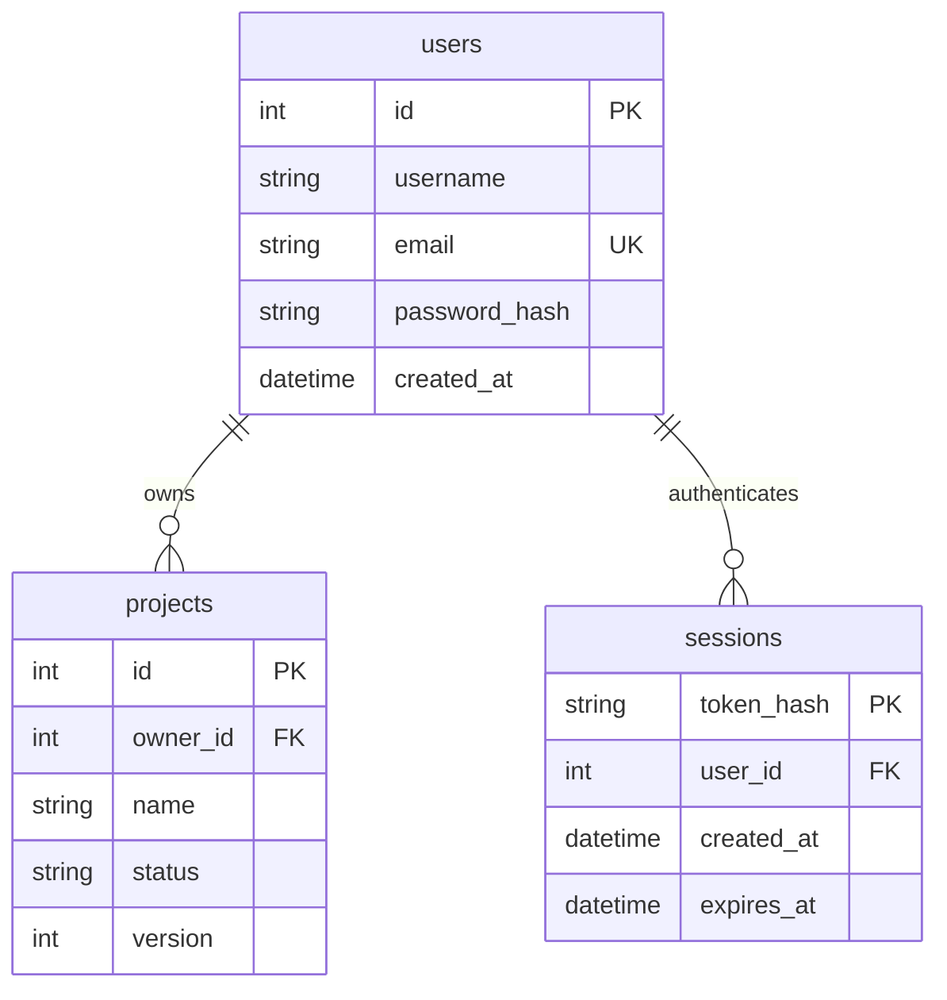

# FlowDesk 源码说明

FlowDesk 是 AI 驱动的个人与小团队工作管理平台：**桌面客户端（Electron）＋云端服务端**。本目录包含后端（FastAPI + SQLite）、前端（Vue 3 + Vite）与桌面壳（Electron）三部分源码。版本号 0.2.0；里程碑 M1–M9 均已完成。

## 已实现的范围

- **M1 Project**：项目增删改查、搜索筛选、日期校验、乐观锁、JSON 导出。
- **M2 Account**：注册/登录/退出/保持登录、会话管理、scrypt 密码哈希、按 owner_id 的权限隔离、登录限流、数据库迁移与备份（本文件以下部分详述）。
- **M3 Workspace**：空间 + 成员多对多、Owner/Admin/Member 角色权限矩阵、按邮箱邀请成员。
- **M4 Task**：任务全生命周期（状态/优先级/负责人/截止日/If-Match 乐观锁）。
- **M5 Files**：项目附件上传/下载/删除（本地存储、文件名消毒）。
- **M6 Dashboard**：空间/项目统计聚合 + 仪表盘视图。
- **M7 Collaboration**：任务评论 + 活动动态（全员留痕）。
- **M8 AI Copilot**：AI 会话、项目理解、任务提案（经确认才落库，OpenAI 兼容 API）。
- **M9 Desktop + 服务端化**：Electron 桌面客户端（自动拉起后端）、联网服务端模式（跨源/Host 白名单、局域网 UDP 自动发现、远程访问），见 `desktop/README.md` 与仓库根 `03-技术架构.md` §7。

资料编辑、头像、修改密码、找回密码、邮箱验证、OAuth 不在当前范围内。M1 的无账号项目由首次注册用户明确确认后接收。本次交付没有自动迁移用户另存目录的真实数据。

## 最重要的两条链路

**认证 Authentication：你是谁。**

```text
登录表单 → POST /api/auth/login → 校验邮箱与密码
→ scrypt 验证数据库中的密码哈希
→ 生成随机会话令牌 → 数据库存令牌的 SHA-256 摘要
→ 浏览器接收 HttpOnly Cookie
→ 后续请求自动携带 Cookie → 后端查询有效会话 → 得到 User
```

**授权 Authorization：你能访问什么。**

```text
用户请求 Project → current_user 识别登录用户
→ 查询同时要求 project.id = 目标编号 AND owner_id = 当前用户编号
→ 满足条件才返回、修改或删除
→ 其他用户的项目统一返回 404，匿名返回 401
```

前端只是展示层。即使绕过界面，直接调用 API，也不能读写别人的项目。创建项目时 owner_id 由服务器取当前用户 ID，客户端不能指定归属。

## 数据模型



项目的描述、日期和时间字段保持 M1 原样。`owner_id` 在数据库层允许为空，仅为兼容首次注册前的旧数据；新建项目 API 始终设置非空 owner_id。无归属项目不会出现在任何普通账号的项目查询中。

辅助表：`app_settings` 保存数据库实例标识与 schema_version=2；`login_attempts` 保存登录失败计数和窗口时间。

## 代码导航

| 文件 | 负责内容 |
| --- | --- |
| frontend/src/App.vue | 登录门禁、注册登录界面、当前账号、跨页面账号状态同步、路由 |
| frontend/src/Projects.vue | 项目界面与项目请求 |
| frontend/src/Workspaces.vue | 空间与成员管理界面（M3） |
| frontend/src/TaskView.vue | 任务看板/详情界面（M4） |
| frontend/src/views/FilesView.vue | 附件上传下载界面（M5） |
| frontend/src/views/DashboardView.vue | 仪表盘界面（M6） |
| frontend/src/views/CommentSection.vue、ActivityView.vue | 任务评论与活动动态（M7） |
| frontend/src/views/AIView.vue | AI Copilot 会话界面（M8） |
| frontend/src/api.ts | HTTP 请求、超时和错误处理 |
| frontend/src/auth.css、style.css | 界面样式 |
| backend/models/ | 各表模型：User/Session、Project、Workspace/Membership、Task、File、Comment/Activity、AI 会话 |
| backend/routers/ | 各资源 API：projects、workspaces、tasks、files、collaboration、dashboard、ai |
| backend/auth.py | 注册登录、会话、当前用户、登录节流 |
| backend/security.py | 密码哈希、密码验证、令牌摘要 |
| backend/app.py | 应用入口：安全中间件、认证与各路由挂载、静态资源服务、跨源/Host 白名单（M9） |
| backend/migrations.py | 数据库备份与增量升级 |
| backend/backup.py | 完整数据库备份，移除副本中的会话 |
| launcher.py | 本地服务启动、浏览器/无头模式、局域网 UDP 广播、全库备份 |
| desktop/main.js | Electron 主进程：启动决策链、后端进程管理、窗口（M9） |
| desktop/preload.js | 预加载脚本：最小权限暴露只读信息 |

## 认证接口

| 方法 | 路径 | 结果 |
| --- | --- | --- |
| GET | /api/auth/setup | 是否首次注册、可接收的旧项目数量 |
| POST | /api/auth/register | 创建账号、建立会话，201 |
| POST | /api/auth/login | 验证凭据、建立新会话，200 |
| POST | /api/auth/logout | 注销当前会话并删除 Cookie，204 |
| GET | /api/auth/me | 当前用户公开信息；未登录 401 |

注册输入：

```json
{"username":"我的名称","email":"me@example.com","password":"a long personal passphrase","remember":true,"claim_legacy":false}
```

登录输入：email、password、remember。退出无请求体。

返回的用户信息仅有 id、username、email、created_at，不包含密码哈希。邮箱去首尾空白并统一小写；密码不去空白、不静默截断。用户名允许重复，邮箱唯一，登录仅使用邮箱。

项目接口仍是 GET/POST `/api/projects` 和 GET/PATCH/DELETE `/api/projects/{id}`。GET `/api/export` 仅导出当前用户项目。PATCH 可清空日期；名称、状态、描述不能传 null。

写接口需要 `X-FlowDesk-Token`，由前端从本次启动的 HTML meta 标签读取；校验 Origin 防止跨站写入。项目请求额外携带 `X-FlowDesk-User`，防止用户在另一个页面切换账号后，旧页面将操作提交到新账号。修改与删除沿用 `If-Match` 乐观锁版本号。

错误码：401 未登录或会话失效；403 请求校验失败；404 项目不存在或无权访问；409 邮箱重复、旧项目接收未确认、账号切换或编辑冲突；422 输入无效；429 尝试过于频繁。

## 密码与会话实现

- scrypt：N=32768、r=8、p=3，随机 16 字节盐、32 字节输出，常量时间比较。参数与盐随哈希编码保存。
- 会话令牌由 32 字节随机数生成；数据库仅存其 SHA-256 摘要。
- Cookie 使用 HttpOnly、SameSite=Strict、Path=/api，无 Domain。名称包含数据库实例随机标识，避免不同项目库在同一本地主机上的 Cookie 冲突。
- 勾选保持登录：Cookie 与服务器会话均为 30 天绝对有效期。未勾选：会话 Cookie，服务器有效期最多 8 小时。
- 登录成功轮换当前浏览器的会话；退出从数据库删除当前会话。重启服务不会丢失未过期的有效会话。
- 登录失败：每个邮箱 15 分钟窗口内最多 5 次；每个运行进程每分钟最多 30 次注册/登录尝试。失败计数持久保存，进程总量限制保存在内存。本地版不是分布式限流系统。
- 不存在的邮箱也验证一个占位哈希，登录错误统一为“邮箱或密码不正确”。

实现参考：[OWASP 密码存储指南](https://cheatsheetseries.owasp.org/cheatsheets/Password_Storage_Cheat_Sheet.html) 与 [OWASP 会话管理指南](https://cheatsheetseries.owasp.org/cheatsheets/Session_Management_Cheat_Sheet.html)。

**本地运行边界：** 默认 HTTP 回环地址，Cookie 未设置 Secure，不能直接用于公网部署。部署到网络前必须加入 HTTPS/Secure Cookie、可信代理与域名配置、部署级限流和进一步安全审查。应用账号隔离不等于磁盘加密；持有本机数据库文件的人能直接访问内容。启动窗口备份是本机全库管理操作，不受网页登录账号的项目范围限制。

## M1 数据迁移

1. 检查 projects 是否缺少 owner_id。
2. 若是 SQLite 旧库，先使用 SQLite backup API 复制到同级 backups 文件夹；失败直接终止，不继续改表。
3. 新建 users、sessions 等表，并给旧项目表追加 owner_id 与索引；原有项目字段不删除、不改写。
4. 首次注册使用数据库事务与写锁，检查有没有账号和无归属项目。
5. 存在旧项目时，必须明确传 claim_legacy=true；账号创建和全部旧项目归属写入同一事务，失败会整体回滚。
6. 以后启动不会再次迁移或重复备份，后续账号也不能领取旧项目。

这是有测试覆盖的一次性增量迁移；尚未引入 Alembic 通用迁移历史。增加 Workspace 等新表结构时应继续设计明确迁移，并逐步接入 Alembic。

SQLite 是本次验证的数据库。保留 `FLOWDESK_DATABASE_URL=postgresql+psycopg://...` 入口和驱动，但没有进行 PostgreSQL 实例联调；PostgreSQL 升级前须使用数据库自身工具备份，当前自动备份只针对 SQLite。切换数据库不会自动复制数据。

## 从源码运行与重新打包

需要 Python 3.12 与 Node.js 22+。仓库不含编译产物，首次运行需先构建前端。

**Windows**（在 source 文件夹执行）：

```powershell
python -m venv .venv
.\.venv\Scripts\python.exe -m pip install -r requirements.txt
cd frontend; npm ci; npm run build; cd ..
.\.venv\Scripts\python.exe launcher.py        # 本地单机：自动打开浏览器
```

**macOS / Linux**：

```bash
python3 -m venv .venv
.venv/bin/pip install -r requirements.txt
(cd frontend && npm ci && npm run build)
.venv/bin/python launcher.py
```

前端开发模式（热更新）：`cd frontend && npm run dev`（Vite dev server，配合 `desktop/README.md` 的 VITE_DEV_SERVER_URL 使用）。

**桌面客户端**（Electron，Win/Mac 通用）：见 `desktop/README.md`。

**正式安装包（Win + Mac）**：推送 `v*` 标签后由 GitHub Actions 自动构建（`.github/workflows/release.yml`），产物发布到仓库 Releases 页面：Windows NSIS 安装包 + 便携 zip，macOS dmg（Apple Silicon 与 Intel 各一份）。本地手动打包：

```powershell
# Windows：后端 PyInstaller onedir → dist\flowdesk-backend\，再 electron-builder
powershell -ExecutionPolicy Bypass -File .\build.ps1   # 浏览器版单文件 EXE → release\FlowDesk.exe
```

运行成品不需要网络；安装构建依赖时需要网络。不要把生成目录、真实 data、密码、数据库备份或 .env 提交到 Git。

## 测试与验证

后端共 43 项测试，覆盖账号、项目回归、权限隔离、Cookie、注销重放、过期会话、错误输入、失败次数限制、旧库备份、原子接收、重启保持与备份移除会话：

```powershell
.\.venv\Scripts\python.exe -m pytest tests/test_projects.py tests/test_auth.py -q
```

浏览器测试需要 Edge 和 `npm ci --prefix frontend`。用全新的测试数据库启动，再在另一个终端执行：

```powershell
.\.venv\Scripts\python.exe launcher.py --headless --port 18747 --data-dir .\test-data
node tests/account-browser.cjs
node tests/browser.cjs
```

测试会创建测试账号和演示项目，不能指向真实数据。再次运行应使用新的测试目录。截图保存在 test-results。`FLOWDESK_TEST_URL` 可覆盖测试地址；默认是 18747。

成品测试（仅 Windows）：

```powershell
.\.venv\Scripts\python.exe tests/packaged.py ..\FlowDesk.exe
```

它会在 test-results/packaged 中新建一份独立 M1 数据库，启动 EXE 验证迁移、接收、双账号权限、持久登录、重启数据、退出，再关闭测试进程。不会使用真实 data。

桌面运行时自检：

```powershell
..\FlowDesk.exe --self-test --data-dir .\test-runtime
```

成功时生成 runtime-check.json 并自动退出。

本次实测环境：本机 Windows 11 x64 + Edge。后端 43 项通过，浏览器账户与 Project 流程通过，桌面和 390px 窄屏检查通过，打包 EXE 迁移与重启测试通过。其他机器及 PostgreSQL 未实测。EXE 尚未商业签名。
